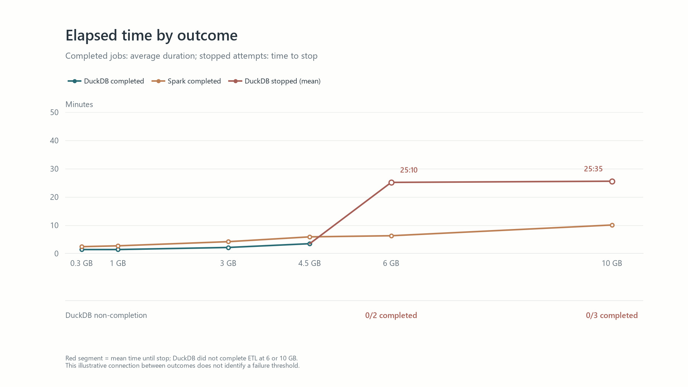
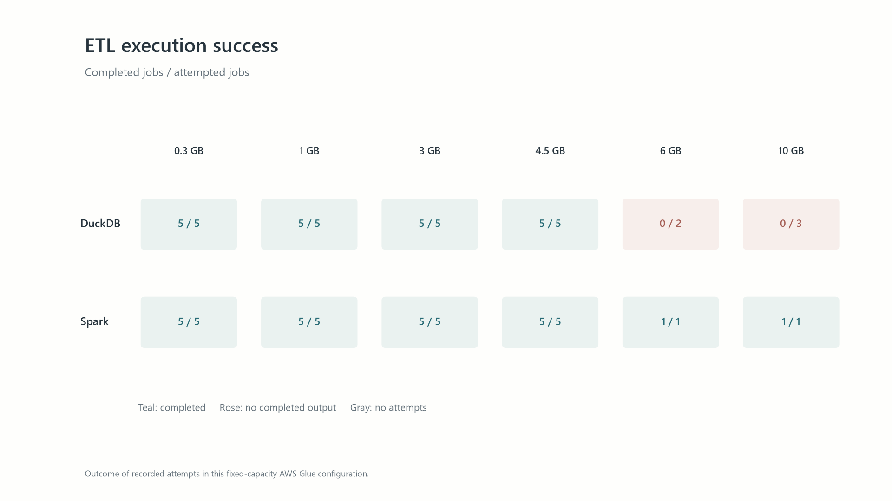
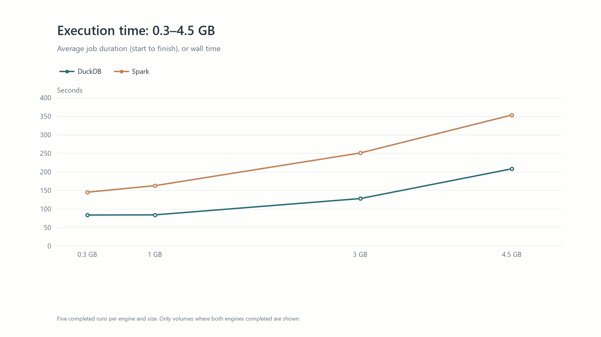
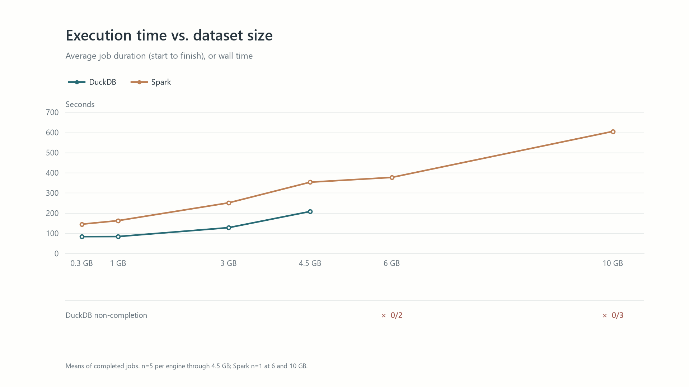
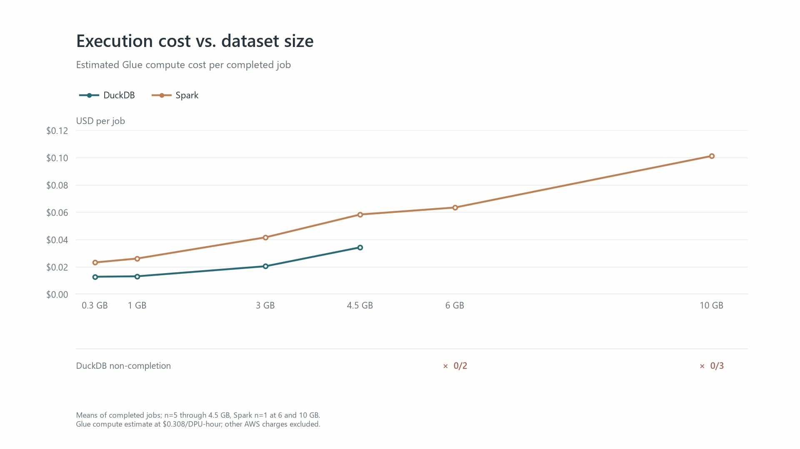

# Scaling DuckDB and Apache Spark on AWS Glue

An experimental extension of the [AWS Big Data Blog's DuckDB and S3 Tables ETL benchmark](https://aws.amazon.com/blogs/big-data/cost-effective-etl-with-duckdb-and-amazon-s3-tables-on-aws-glue/).

## Research question

**How do execution time and infrastructure cost evolve for DuckDB and Apache Spark as input volume increases under comparable conditions on AWS Glue?**

The purpose is to identify the conditions in which each implementation is practical. This is a fixed-capacity scaling experiment, not a claim that one engine is universally better. The original contribution is the technical and economic scaling series: repeated measurements at several input sizes, explicit controls, observed failures, and an evidence-based interpretation.

## Workload

Both jobs read the same Snappy Parquet transaction files from Amazon S3, exclude cancelled orders, and aggregate by day, region, and category. They compute order counts, gross and net revenue, distinct customers, average order value, and high-value order counts. Each job writes its result to a separate Apache Iceberg table in Amazon S3 Tables; Amazon Athena is used for output checks. The experiment used AWS Glue 6.0 in `us-east-1` with two G.1X workers per job. DuckDB 1.5.1 ran inside the Glue driver; Spark used the Glue 6.0 runtime.

The synthetic dataset follows the published example's schema and main distributions. Our [local Spark script](jobs/spark_order_summary.py) implements an equivalent transformation for this comparison. The AWS article describes its Spark job but does not publish a complete Spark script there that would establish identical code. AWS's published measurements and this project's measurements are separate datasets of evidence; this is an **experimental extension of the AWS case**, not an exact reproduction of its run times.

## Observed scaling

Input size is the measured compressed S3 object total in decimal GB. Times show **average job duration (start to finish), or wall time**, for successful runs. The 0.097 GB pilot includes one overlapping pair; the other four pairs were sequential. All later paired runs were sequential.

| Input | Files | DuckDB | Spark | Successful paired trials |
| ---: | ---: | ---: | ---: | ---: |
| 0.097 GB | 12 | 87.4 s | 150.0 s | 5 |
| 0.300 GB | 36 | 83.6 s | 145.2 s | 5 |
| 0.968 GB | 120 | 84.0 s | 162.8 s | 5 |
| 3.002 GB | 372 | 128.0 s | 251.0 s | 5 |
| 4.503 GB | 558 | 208.2 s | 353.4 s | 5 |
| 6.005 GB | 744 | No completed run in 2 attempts | 377 s, 1 run | 0 |
| 10.072 GB | 1,248 | No completed run in 3 attempts | 605 s, 1 run | 0 |

Under this fixed configuration, DuckDB completed faster at every size where both jobs completed. At 6 and 10 GB, Spark completed once per size and DuckDB did not complete. Spark distributes tasks across workers, while this DuckDB job runs in the Glue driver; the larger-volume results show why the engine must be chosen for the workload. They do not establish that distribution caused DuckDB's failures, an exact capacity threshold, or a general limit of DuckDB. Failed-run durations are excluded from successful-run averages.

The cost metric is estimated Glue compute cost, calculated from reported DPU-hours using the provisional USD 0.308 per DPU-hour rate quoted in the AWS article. This estimate excludes storage, requests, Athena, logs, and other charges. See the [run-level records](results/README.md) for measurement definitions and the [findings](findings.md) for interpretation.

## Results in five figures

These figures use the run-level records in [`results/`](results/). They show the six-stage expanded series; the 0.097 GB pilot is documented in the table above and the CSVs but is omitted here because its input-generation conditions differed. It still showed a substantial difference: DuckDB averaged 87.4 s versus Spark's 150.0 s, about 41.7% less time. Spark has only one completed run at 6 and 10 GB, so its variation at those sizes cannot be estimated.

### 1. Duration and outcome

DuckDB's completed jobs were faster through 4.5 GB. At 6 and 10 GB, its attempts did not complete, while Spark completed one run at each size. The red values show **average time until an attempt stopped**, not completed ETL duration. The line between outcomes is illustrative and does not identify a failure threshold.

### 2. Completion by engine and input size

Both engines completed all five recorded runs per size through 4.5 GB. DuckDB completed 0/2 attempts at 6 GB and 0/3 at 10 GB; Spark completed 1/1 at each larger size. These counts describe this fixed-capacity configuration, not a universal limit for either engine.

### 3. Duration where both engines completed

This focused view shows the four expanded-series volumes with five completed runs per engine. DuckDB's average job duration was approximately 41%–49% lower than Spark's across these sizes. The 6 and 10 GB stages are excluded because DuckDB did not complete a run there.

### 4. Duration of all completed jobs

The curves include successful runs only. DuckDB had lower average job duration at every size where both engines completed; its failed attempts are shown separately below the axis rather than treated as completed jobs.

### 5. Estimated Glue compute cost

For completed jobs through 4.5 GB, DuckDB's estimated compute cost was approximately 41%–51% lower. The estimate uses **USD 0.308 per DPU-hour** and excludes S3, Athena, logs, and other AWS charges. Failed attempts still incur cost, as discussed in [findings](findings.md).

The five PNGs are in [`figures/`](figures/). They can be regenerated from the CSVs with `python scripts/generate_figures.py` after installing Matplotlib.

## Documentation and data

- [Methodology and variable controls](methodology.md)
- [Findings and limitations](findings.md)
- [Run-level measurement definitions](results/README.md)
- [Figure generator](scripts/generate_figures.py)
- [Synthetic data generator](data_generation/README.md)
- [AWS Glue ETL scripts](jobs/README.md)
- [Sanitized AWS Glue job definitions](configs/README.md)
- [Original 0.097 GB pilot detail](results/glue_8m_five_trials.csv)
- [Combined successful runs, including the pilot](results/glue_scaling_runs.csv)
- [Unsuccessful scaling attempts](results/glue_scaling_failures.csv)

The CSV files preserve the recorded observations. Glue run identifiers are masked to their final five characters. The files contain no AWS account ID, source bucket name, credentials, or generated Parquet data. The data generator, owner-supplied ETL scripts, and sanitized Glue job definitions are included.

## Scope of the conclusions

The comparison holds the allocated worker type and count constant. It does not compare each engine at its individually optimized configuration. All successful DuckDB/Spark output pairs were checked in Athena: counts and groups matched, and floating-point measures matched within an absolute tolerance of 0.01. The cause of the DuckDB failures at 6 and 10 GB remains unconfirmed; Spark's distributed execution is an architectural reason to test it for larger workloads, not a confirmed explanation for those failures. Reliability and interrupted-write behavior are outside the measured scaling result.
